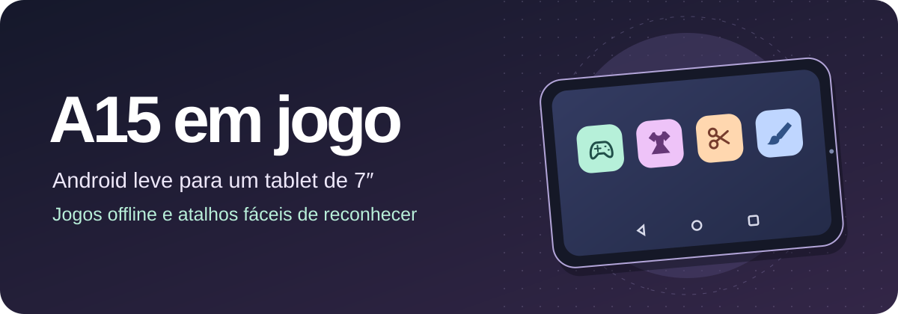

<div align="center">
  

  [](https://github.com/Mreaggle/tablet-a15/releases/latest)
  
  

  [Instalar e testar](#tutorial-rápido) · [Copiar prompt de IA](#prompt-para-agentes-de-ia) · [Ver os APKs](#aplicativos) · [Conhecer a história](#como-o-projeto-evoluiu)
</div>

## Tutorial rápido

Os jogos e utilitários podem ser instalados no Android que já está no tablet. O A15 do projeto foi testado com Android 9. Os APKs próprios pequenos têm API mínima entre 23 e 26. O Chogan exige Android 7 ou superior. A compatibilidade também depende do WebView, especialmente para os jogos.

1. **Identifique o aparelho.** Em *Opções do desenvolvedor*, ative a depuração USB, conecte um cabo de dados e aceite a autorização na tela do tablet. Instale o [ADB do Android Platform-Tools](https://developer.android.com/tools/releases/platform-tools) no computador e confira os comandos a seguir. Para instalar só os APKs, também é possível baixá-los no tablet e abri-los no gerenciador de arquivos.
   ```bash
   adb devices -l
   adb shell getprop ro.product.board
   adb shell getprop ro.product.cpu.abilist
   ```
   A unidade deste projeto retornou `tb8735ba1_bsp` e `armeabi-v7a,armeabi`. Ao compartilhar o diagnóstico, remova o número de série exibido pelo ADB.
2. **Guarde as fotos e os dados importantes localmente.** Se precisar copiar as fotos da câmera, use um diretório fora do repositório e abra algumas delas para confirmar a cópia.
   ```bash
   adb pull /sdcard/DCIM/Camera ../backup-local/camera
   ```
3. **Baixe os APKs que você quer usar.** A [versão publicada](https://github.com/Mreaggle/tablet-a15/releases/latest) inclui os arquivos e seus SHA-256. Abra o terminal na pasta dos downloads. Remova da sequência os apps que quiser pular.
   ```bash
   adb install -r Chogan-A15.apk
   adb install -r DollMaker-offline.apk
   adb install -r Princesas-A15.apk
   adb install -r Salao-A15.apk
   adb install -r Otimizar-A15.apk
   ```
   Se houver conflito de assinatura com um app já instalado, exporte os dados dele antes de decidir sobre a substituição. Desinstalar um app pode apagar seu progresso.
4. **Monte a tela inicial.** Arraste os jogos da gaveta para a tela inicial. Para os atalhos alternativos de jogos e vídeo, instale `Icones-A15.apk` e abra o seletor abaixo. Toque no atalho desejado e confirme no launcher. O app de destino precisa estar instalado e o launcher precisa oferecer suporte a atalhos fixados.
   ```bash
   adb install -r Icones-A15.apk
   adb shell am start -n org.tableta15.icones/.PinActivity
   ```
5. **Teste com o Wi-Fi desligado.** Abra os jogos e confira o toque e a rotação. Para vídeo, ligue o Wi-Fi e teste a reprodução comum e os Shorts separadamente. Confira o ADB de novo após bloquear, desbloquear e reconectar o cabo.

> [!IMPORTANT]
> A troca de firmware é opcional. Firmwares de tablets chamados “A15” podem ser incompatíveis entre si. Se quiser reproduzir a troca, confira a identificação, o backup e os pré-requisitos no [guia de firmware](docs/firmware.md) antes de desbloquear ou gravar qualquer partição.

## Prompt para agentes de IA

Copie a caixa abaixo para um agente que tenha acesso ao seu terminal. Edite os campos entre colchetes.

```text
Quero replicar o projeto A15 em jogo no meu tablet Android.
Repositório e tutorial: https://github.com/Mreaggle/tablet-a15
Meu computador: [Windows, Linux ou macOS]
Meu objetivo: [só instalar os apps / também avaliar a troca de firmware]
Apps desejados: [Chogan, DollMaker, Princesas, Salão, Otimizar, Ícones, vídeo]
Dados que preciso preservar: [fotos da câmera e outros arquivos importantes]

Leia o README, a release e os guias aplicáveis. Use o ADB para confirmar
placa, versão do Android, ABIs, espaço livre e estado da conexão. O nome
A15 sozinho não confirma compatibilidade. Se o tablet não aparecer,
verifique o cabo de dados, a autorização de depuração e o driver adequado.

Guarde os dados solicitados em uma pasta local fora do Git. Confirme
que a cópia abre. Não publique fotos, capturas pessoais, números de série,
chaves de assinatura nem imagens de partições. Verifique as somas dos
downloads antes de instalar. Use o Android atual para instalar e testar
os APKs quando ele for compatível. Preserve o progresso existente.

Só avalie a troca de firmware se estiver no meu objetivo. Antes de
desbloquear, apagar ou gravar partições, confirme o layout, o estado do
bootloader e os meios de recuperação. Explique o efeito e aguarde minha
confirmação explícita. Se a variante não puder ser confirmada, preserve
o firmware atual.

Teste os jogos com Wi-Fi desligado, os atalhos, os botões de navegação e
o ADB após reconectar. Para vídeo, teste vídeo comum e Shorts com Wi-Fi.
Ao final, liste o que mudou, o que foi medido e o que ficou sem teste.
```

## Aplicativos

Os jogos abaixo têm os recursos incluídos no APK para uso offline e dispensam anúncios durante o jogo. O peso do download é diferente do espaço ocupado depois da instalação.

| APK | Download | O que faz |
| --- | ---: | --- |
| **Chogan-A15** | 5,98 MiB | Coleção de jogos como Echo e Lights Off, com correções no tamanho de seis tabuleiros para WebView antigo. |
| **DollMaker-offline** | 983 KiB | Montagem de bonecas em português. Salva as montagens dentro do jogo e omite o botão de exportar imagem. |
| **Princesas-A15** | 1,47 MiB | Quatro bonecas, seis cenários e opções de roupas e acessórios. Usa imagens reduzidas e mantém as escolhas localmente. |
| **Salao-A15** | 1,30 MiB | Jogo de salão para cortar, pentear e pintar o cabelo. Abre na horizontal e funciona offline, sem a trilha original. |
| **Otimizar-A15** | 20,5 KiB | Atalho que solicita ao Android o encerramento de processos elegíveis em segundo plano e limpa seu próprio cache. |
| **Icones-A15** | 16,8 KiB | Atalhos visuais para os jogos e o app de vídeo. A edição pública usa um ícone de vídeo próprio. |
| **Shorts-A15** | 12,5 KiB | Atalho que abre o site oficial de Shorts. Usa internet e a página pode exibir anúncios. |

[GCompris](https://gcompris.net/downloads-pt_BR.html) tem build ARM32. [Colorbook](https://f-droid.org/packages/com.sidhant.colorbook/) e [KidOrb](https://f-droid.org/packages/com.wian.kidorb/) são opções que também ficaram no tablet. Para vídeo, o teste bem-sucedido usou o [StreamTube build 119 ARM32](https://github.com/shreyas-bangera/streamtube/releases/tag/build-119). Esses apps são baixados nos projetos originais.

## A ideia

Dar uma segunda vida a um tablet infantil de 7 polegadas que vinha lento e com muitos apps de fábrica. A meta era reduzir a carga do Android e concentrar a tela inicial em jogos offline leves, com ícones que uma criança ainda aprendendo a ler conseguisse reconhecer. O YouTube e os Shorts também faziam parte do uso diário, por isso a reprodução de vídeo entrou nos testes.

## Como o projeto evoluiu

| Etapa | Decisão e resultado |
| --- | --- |
| **1 · Inventário e backup** | A depuração USB permitiu medir o hardware e salvar as fotos localmente. CPU, RAM e armazenamento medidos ficaram bem abaixo dos números do anúncio semelhante. |
| **2 · Primeira GSI** | A imagem experimental de Android 8.1 iniciou, mas os três ícones de navegação ficaram gigantes e sobrepostos. Ajustar a densidade e testar opções do renderizador e de sobreposição de hardware não resolveu. |
| **3 · AOSP 9 Vanilla** | A GSI PHH v123 ARM32 A-only iniciou sem o pacote Google pré-instalado. A interface começou com um único indicador de navegação. Uma configuração posterior recuperou Voltar, Início e Recentes separados e funcionais. |
| **4 · USB** | Houve perdas de conexão após a troca. Em algumas entradas no bootloader, a tela ficou preta e acesa, com o reconhecimento USB dependente do modo e do driver. O diagnóstico final registrou o ADB ativo com um ajuste de inicialização. A estabilidade do MTP ficou sem validação. |
| **5 · Jogos e vídeo** | Jogos offline foram adaptados ao WebView antigo, receberam atalhos visuais e passaram por testes físicos. O Flow serviu para comparar Shorts, mas acabou removido. O StreamTube voltou à tela inicial depois que um Short reproduziu ao tocar no Play. |
| **6 · Manutenção** | O atalho Otimizar passou a mostrar sua execução e a preservar os processos essenciais que ele identifica. O plano de bateria ficou documentado e os ganhos de autonomia ficaram por medir. |

### Três detalhes da adaptação

- **Navegação.** A tela de bloqueio se comportava normalmente enquanto a interface inicial falhava no Android 8.1 experimental. A unidade ficou com AOSP 9, densidade lógica de 160 dpi e três botões. O comando histórico exato da correção dos botões ficou sem registro recuperável.
- **WebView.** No Echo, as cores ficavam invisíveis porque o tabuleiro dependia de uma propriedade CSS que o WebView 66 ignorava. O mesmo tipo de dimensão foi corrigido em seis jogos conhecidos do Chogan. Outros jogos podem exigir testes próprios.
- **Memória.** O Otimizar usa a API do Android para processos em segundo plano, poupa componentes como launcher e teclado e limpa o cache do próprio app. A tela de Recentes pode manter o cartão de um processo já encerrado. A RAM disponível varia com o uso.

## O tablet medido

O anúncio abaixo foi usado como referência por apresentar um tablet semelhante. A correspondência com o vendedor e o lote do aparelho testado ficou sem confirmação. [Anúncio de referência](https://www.amazon.com.br/dp/B0GKHW6R8G)

| Item | Anúncio de referência | A15 analisado |
| --- | --- | --- |
| CPU | Octa-core Cortex-A53, 64 bits | Quatro Cortex-A53 detectados. A plataforma se identifica como MT6737M e o Android expõe ABI ARM de 32 bits. |
| RAM | 8 GB | Cerca de 1 GB físico inferido pelas zonas do kernel. O valor reportado por outras interfaces era inconsistente. |
| Armazenamento | 128 GB | eMMC de cerca de 15,7 GB decimais, da classe de 16 GB. |
| Tela | 7″ IPS, 1024 × 600 | 1024 × 600 a cerca de 60 Hz. A tecnologia do painel ficou sem confirmação. |
| Wi-Fi | 2,4 e 5 GHz | Conexões nas duas bandas observadas. |
| Câmeras e bateria | 5 MP frontal, 8 MP traseira, 4.000 mAh | Duas câmeras detectadas. Resoluções nativas e capacidade efetiva da bateria sem confirmação. |

| Configuração | Antes | Depois |
| --- | --- | --- |
| Sistema | Android 8.1 de fábrica, build `W8658M1_SLSM_A15-S8J_116-JFT2K_20260313` | PHH AOSP 9 v123 Vanilla `arm-aonly-vanilla-nosu`, mantendo vendor e kernel de fábrica. |
| Bootloader | Bloqueado | Desbloqueado. |
| Apps | Pacote Google e apps adicionais de fábrica | Jogos offline selecionados, atalhos, Otimizar e StreamTube. |
| Espaço livre em `/data` | 5,91 GiB | 9,63 GiB medidos após reset e troca de sistema. |
| Bateria | Brilho manual e tela ligada por 60 s em inatividade no diagnóstico | Plano reversível preparado. Autonomia sem medição comparativa. |

## Guias e código

- [Firmware, recuperação e diagnóstico USB](docs/firmware.md)
- [Como compilar e assinar os APKs](docs/compilar.md)
- [Plano de bateria](docs/bateria-a15.txt)
- [Origens, licenças e créditos](docs/creditos.md)

O repositório reúne código, jogos, ícones próprios e documentação. As fotos da câmera, as capturas privadas, as chaves de assinatura e os dumps do aparelho ficaram locais.
